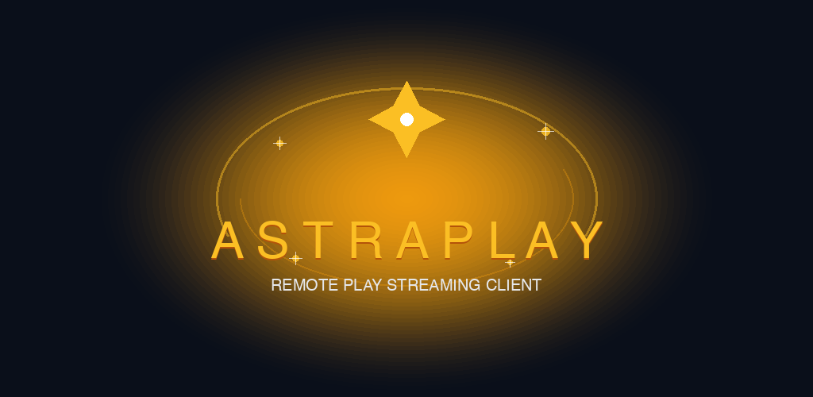

# AstraPlay

[](https://github.com/nileshchakraborty/AstraPlay/blob/master/LICENSES/AGPL-3.0-only-OpenSSL.txt)
[%20%7C%20macOS%20(Apple%20Silicon%20%2B%20Intel)%20%7C%20Linux%20(x86__64%20%2B%20ARM64)%20%7C%20Android%20%7C%20iOS-brightgreen)](https://github.com/nileshchakraborty/AstraPlay/releases)
[](https://github.com/nileshchakraborty/AstraPlay/actions/workflows/release-on-merge.yml)
[](https://github.com/nileshchakraborty/AstraPlay/releases/latest)

**AstraPlay is a high-performance, 100% free and open-source PlayStation (PS4 & PS5) Remote Play client for Windows, macOS, Linux, SteamOS, Bazzite, Android, and iOS.**

Engineered for ultra-low latency, crisp visuals, and cross-platform flexibility, AstraPlay delivers native hardware-accelerated video streaming, seamless local and Internet Play, gamepad navigation for handheld devices, and private self-hosted authentication options.

---

## Key Highlights

- **100% Free & Open-Source**: Zero paywalls, zero locked features, zero subscription gates, and zero donation nags. All features are fully unlocked for everyone.
- **True Multi-Platform**: Native binaries for Windows (x64 and ARM64), macOS (Apple Silicon and Intel), Linux (x86_64 and aarch64), Android (Phones, Tablets, and Android TV), and iOS/iPadOS.
- **Handheld-First Design**: Tailored for the **ROG Xbox Ally X**, **Steam Deck**, **Lenovo Legion Go**, and **MSI Claw** with gamepad UI navigation, customizable controller bindings, and Quick Access Menu (QAM) integrations.
- **Ultra-Low Latency & High Fidelity**: Hardware-accelerated decoding via **Vulkan**, **Metal**, **D3D11VA**, **VAAPI**, **VideoToolbox**, and **AMediaCodec** with full support for HDR, AV1, HEVC, and H.264 codecs.
- **Inbuilt QR Code Authentication**: Pair and sign in to PlayStation Network seamlessly using the built-in, offline QR code generator directly inside the Settings and Login dialogs.
- **Private Self-Hosted Token Relay**: Full support for self-hosting the authentication relay via `psstream-server` for zero third-party telemetry and complete network sovereignty.
- **Seamless Settings Migration**: Automatically discovers and inherits configurations from `pylux.conf` and `Chiaki.conf` so previously registered consoles, keys, and bitrate settings carry over instantly.
- **Integrated In-App Updates**: Built-in background update checker (`UpdateManager`) in Settings with one-click download, automated package extraction, and stale file cleanup.

---

## Downloads & Supported Packages

All release binaries, packages, and SHA-256 checksums are published on the [**GitHub Releases Page**](https://github.com/nileshchakraborty/AstraPlay/releases/latest).

| Operating System | Architecture | Available Packages | Description |
| :--- | :--- | :--- | :--- |
| **Windows** | **x86_64** (Desktop, ROG Xbox Ally X) | [`.exe Setup Installer`](https://github.com/nileshchakraborty/AstraPlay/releases/latest)<br>[`.msi WiX Installer`](https://github.com/nileshchakraborty/AstraPlay/releases/latest)<br>[`.zip Portable`](https://github.com/nileshchakraborty/AstraPlay/releases/latest)<br>[`Standalone .exe`](https://github.com/nileshchakraborty/AstraPlay/releases/latest) | Full Inno Setup installer (`astraplay-windows-installer.exe`), WiX MSI package (`astraplay-windows-x64.msi`), portable runtime ZIP, or standalone executable. |
| **Windows** | **ARM64** (Snapdragon X Elite, WoA) | [`.exe Setup Installer (ARM64)`](https://github.com/nileshchakraborty/AstraPlay/releases/latest)<br>[`.zip Portable (ARM64)`](https://github.com/nileshchakraborty/AstraPlay/releases/latest)<br>[`Standalone .exe (ARM64)`](https://github.com/nileshchakraborty/AstraPlay/releases/latest) | Native Windows on ARM Inno Setup installer (`astraplay-windows-arm64-installer.exe`), portable ARM64 ZIP, or standalone ARM64 executable. |
| **macOS** | **Apple Silicon** (`arm64`: M1–M4) | [`.dmg Disk Image (arm64)`](https://github.com/nileshchakraborty/AstraPlay/releases/latest)<br>[`.zip App Bundle (arm64)`](https://github.com/nileshchakraborty/AstraPlay/releases/latest) | Native Apple Silicon `.dmg` installer and compressed `AstraPlay.app` bundle. |
| **macOS** | **Intel** (`x86_64`) | [`.dmg Disk Image (x86_64)`](https://github.com/nileshchakraborty/AstraPlay/releases/latest)<br>[`.zip App Bundle (x86_64)`](https://github.com/nileshchakraborty/AstraPlay/releases/latest) | Native Intel x86_64 `.dmg` installer and compressed `AstraPlay.app` bundle. |
| **Linux & Handhelds** | **x86_64** (Steam Deck, ROG Ally, PC) | [`.AppImage (x86_64)`](https://github.com/nileshchakraborty/AstraPlay/releases/latest)<br>[`.zip Portable (x86_64)`](https://github.com/nileshchakraborty/AstraPlay/releases/latest) | Portable AppImage executable and Steam-ready ZIP archive with `launch.sh` for Steam Deck and Bazzite Gaming Mode. |
| **Linux & Handhelds** | **ARM64** (`aarch64`: Raspberry Pi 5, SBCs) | [`.AppImage (aarch64)`](https://github.com/nileshchakraborty/AstraPlay/releases/latest)<br>[`.zip Portable (aarch64)`](https://github.com/nileshchakraborty/AstraPlay/releases/latest) | Native ARM64 AppImage executable and portable archive. |
| **Android** | **Universal / ARM64 & x86** (Phones, Tablets, TV) | [`.apk Package`](https://github.com/nileshchakraborty/AstraPlay/releases/latest)<br>[`.aab Play Store Bundle`](https://github.com/nileshchakraborty/AstraPlay/releases/latest) | Sideloadable release APK and Google Play Store App Bundle (`io.github.nileshchakraborty.astraplay`), with native binaries for `arm64-v8a`, `armeabi-v7a`, `x86_64`, and `x86`. |
| **iOS / iPadOS** | **ARM64** (iPhone & iPad) | [`.ipa Package`](https://github.com/nileshchakraborty/AstraPlay/releases/latest) | Sideloadable unsigned IPA (AltStore, Sideloadly, LiveContainer, TrollStore) and TestFlight. |

---

## Features & Capabilities

### Console Discovery & Remote Play
- **Local Network Broadcast**: Automatic discovery of PS4 and PS5 consoles on local networks via standard discovery protocols.
- **PIN Pairing**: Fast pairing using the official PlayStation Remote Play registration PIN.
- **Internet Remote Play**: Connect to your home consoles over WAN and mobile networks with port forwarding or UPnP.

### Video & Audio Performance
- **Codec Support**: AV1, HEVC (H.265), and H.264 streaming up to 1080p @ 60 FPS (and PS5 Pro dynamic resolutions).
- **Hardware Decoders**:
  - Windows: D3D11VA, Direct3D12, Vulkan
  - macOS & iOS: Apple VideoToolbox (Metal-backed)
  - Linux: VAAPI, VDPAU, Vulkan Video
  - Android: Android MediaCodec (AMediaCodec NDK)
- **Audio Engines**: Low-latency audio with SDL, Oboe (Android), CoreAudio (Apple), and PulseAudio / PipeWire (Linux).

### Controller & Input Support
- **DualSense & DualShock 4**: Full support for haptic feedback, adaptive triggers, motion sensors (gyro/accelerometer), and touchpad navigation.
- **Xbox & Handheld Controllers**: Native mapping for Xbox wireless controllers, ROG Ally controls, Steam Deck controls, and third-party XInput / DirectInput controllers.
- **Touchscreen Controls**: Highly responsive on-screen overlay controls with multi-touch support for iOS and Android.

---

## Technical Documentation & Architecture

Comprehensive architectural and design documents are available in the repository root:

- [**PRD.md**](PRD.md) — Product Requirements Document, platform roadmap, and UX specifications
- [**ARCHITECTURE.md**](ARCHITECTURE.md) — Subsystem architecture, cross-platform bridging, and data flow
- [**DESIGN.md**](DESIGN.md) — Design systems, UI components, and handheld ergonomics
- [**DATA.md**](DATA.md) — Configuration persistence, token management, and data contracts
- [**SECURITY.md**](SECURITY.md) — Security guardrails, cryptographic keys, and credential boundaries
- [**CODE_STYLE.md**](CODE_STYLE.md) — Engineering standards for C++, Qt/QML, Kotlin, Swift, and CMake
- [**TESTING.md**](TESTING.md) — Testing methodologies, automation suites, and device verification
- [**AGENTS.md**](AGENTS.md) — Developer operating guide and CI/CD policies

---

## Building from Source

### Prerequisites
- **CMake** 3.25+
- **Ninja** build system
- **Python** 3.10+ (with `protobuf`)
- **Qt 6.6+** (`Core`, `Gui`, `Quick`, `Qml`, `Network`, `Svg`, `Widgets`)
- **FFmpeg 6.0+**
- **SDL 2.0+**

### Linux / macOS Desktop
```bash
git clone --recursive https://github.com/nileshchakraborty/AstraPlay.git
cd astraplay
cmake -B build -G Ninja -DCMAKE_BUILD_TYPE=Release
cmake --build build
```

### Windows (MSYS2 MinGW64 / ClangARM64)
```bash
cmake -B build -G Ninja -DCMAKE_BUILD_TYPE=Release
cmake --build build
```

### Android Build
```bash
cd android
./gradlew assembleRelease
# Or use the local automated build helper:
bash build-local.sh
```

### iOS / iPadOS Build
```bash
bash ios/build.sh
```

---

## Self-Hosted Token Relay (`psstream-server`)

If you prefer to authenticate PlayStation Network accounts entirely within your local network without external cloud services:

```bash
cd psstream-server
npm install
npm start
```

The server provides a local web UI on port `8080` to log in to PSN, capture authorization tokens, and relay them to AstraPlay securely.

---

## Responsible Use

AstraPlay is intended for use with games and hardware you legally own and are licensed to access. It does not circumvent digital rights management (DRM), distribute proprietary firmware, or facilitate piracy.

AstraPlay is an independent community project and is not affiliated with, endorsed by, or certified by Sony Interactive Entertainment Inc. PlayStation, PS4, PS5, DualSense, and DualShock are trademarks or registered trademarks of Sony Interactive Entertainment Inc.

---

## Credits & Acknowledgments

AstraPlay is built upon the foundational work of [Chiaki](https://git.sr.ht/~thestr4ng3r/chiaki) and [chiaki-ng](https://github.com/streetpea/chiaki-ng), and succeeds the **Pylux** project. Heartfelt thanks go to the original Chiaki authors, the chiaki-ng maintainers, and open-source contributors across the handheld gaming ecosystem.
